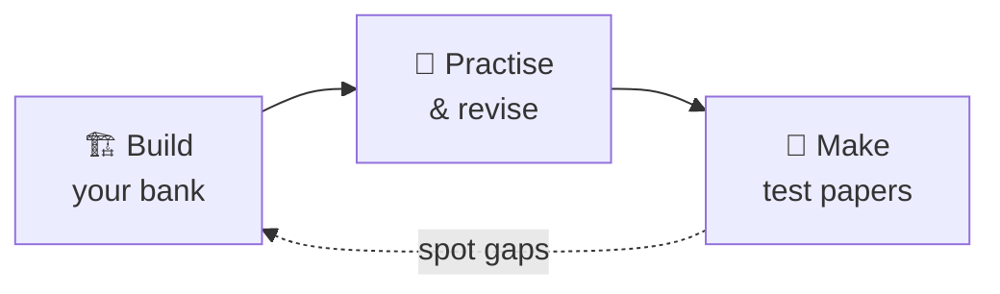

<div align="center">

# 📚 Quaestio

### A calm, flexible place to build a question bank, practise what you know, and make your own test papers.

<br>

[](https://nagasonicdev.github.io/Quaestio/)
[](https://github.com/NagasonicDev/quaestio/issues)


<!-- Add a screenshot or short demo GIF here when one is available. -->

[**Build**](#-build-your-bank) · [**Practise**](#-practise-and-revise) · [**Test papers**](#-make-test-papers) · [**Get started**](#-get-started) · [**Privacy**](#-your-courses-and-privacy)

</div>

---

Quaestio works in your browser and keeps your courses and study history on your device. Start from a ready-made course template or a sample course, then shape the question bank around the way you study.



## 🏗️ Build your bank

| | Feature | What you get |
|---|---|---|
| 🎓 | **Start from a template** | Choose from **54 ready-made HSC course templates** (current syllabus and pre-reform) with the syllabus structure, subject tags, and module topics already in place. Or create a course from scratch with your own hierarchy, difficulty levels, and question types. |
| 🗂️ | **Organise your way** | Questions sit in a course tree of topics and subtopics. Rename or reshape the levels, add categories, and browse or filter by subject, difficulty, question type, tags, institution, and year. |
| ✍️ | **Write rich questions** | A block editor for formatted text, equations (LaTeX), images, diagrams, function graphs, tables, lists, code, and multi-part prompts. Keep the hint, answer, solution/working, and marking criteria with each question, plus source metadata and an **approved** flag for when it is ready for practice and tests. |
| 📖 | **Share passages and data** | Maintain a course-level library of stimuli (passages, tables, data extracts), link them to any number of questions, and they appear beside the question while you study. |
| 📦 | **Bring your questions with you** | Import JSON or `.qbx` question bundles, restore a complete `.qb` course backup (including images, review history, and stimuli), or download a skill file so an AI assistant can author question JSON in Quaestio's import format. |

## 🧠 Practise and revise

### Pick a practice mode

| Mode | What it does |
|---|---|
| 🎯 **Focused practice** | Draws from your current filters. |
| 🔀 **Mixed practice** | A balanced draw across topics and types. |
| ⏰ **Due for review** | Your spaced-repetition queue. The due-queue card tells you what is waiting. |

### Let the schedule drive you

Rate each question and Quaestio spaces your reviews out over days and weeks:

> **Again** · **Hard** · **Got it** · **Easy**

### Everything else

- 💡 **Reveal help gradually.** Hints appear one step at a time before the marking guide, answer, and solution. Multiple-choice questions are scored objectively; free-text answers are self-assessed.
- 📈 **See your progress.** The overview shows practice coverage across the course tree and your recent activity. A session that runs out tells you whether to broaden filters, reset, or repeat, so it's never a dead end.
- ⏱️ **Take a timed quiz.** Pick up to 30 questions, set a timer or go untimed, and flag questions as you go. Finish with an exam summary: score breakdown, per-question outcomes, and a review against the marking criteria.

## 📝 Make test papers

<table>
<tr>
<td width="50%" valign="top">

### 🧩 Build in sections
Give each section a label, a filtered question pool, random or sequential ordering, and a mark total.

### 📎 Attach stimulus material
Linked stimuli are appended to the paper as a numbered **Stimulus Material** section.

</td>
<td width="50%" valign="top">

### 📄 Export as Word or PDF
Both formats produce a full exam paper: cover page with centre and student number boxes, general instructions, examination structure, section headers with time allowances, marks in the margin, answer lines, source credits, and page footers.

### ✅ Get a solutions document
A matching DOCX/PDF of solutions and marking guide, with criteria tables, is generated alongside the paper. Progress is shown while it runs, and generation continues in the background if you navigate away.

</td>
</tr>
</table>

🗃️ **Keep your papers.** Past tests are listed with per-format generation times, ready to re-download or delete.

## 🌗 Study comfortably

- **Dark mode** and a responsive layout that works across phone, tablet, and desktop.
- **Accessible dialogs and menus:** keyboard navigation, Escape to close, and focus returned to where you were.
- **Everything runs locally:** no account, no server, no sync. See [Your courses and privacy](#-your-courses-and-privacy) for how your data is stored.

## 🚀 Get started

### Option 1: Try it online

<div align="center">

### 👉 [**Launch Quaestio**](https://nagasonicdev.github.io/Quaestio/) 👈

</div>

> [!NOTE]
> Your courses are saved in the browser you use to open the site. They are not synced between devices or browser profiles, so export a course backup if you want to move it or keep a copy.

### Option 2: Run it on your computer

**Requirements:** [Node.js](https://nodejs.org/) 20.19 or later (or 22.12 or later).

1. Download or clone this repository.
2. Open the project folder.
3. Start the launcher for your system:

   | Platform | Launcher |
   |---|---|
   | 🪟 Windows | Double-click `Start Quaestio.bat` |
   | 🍎 macOS | Double-click `Start Quaestio.command` |
   | 🐧 Linux | Run `./start.sh` |

4. Keep the terminal window open while you use Quaestio. The launcher opens the app in your browser.

> [!TIP]
> The first launch installs the app's dependencies. After that, start it again with the same launcher whenever you want to study.

## 🔒 Your courses and privacy

Quaestio stores course content, images, stimuli, practice history, review schedules, and generated tests in **browser storage on your device**. The app does not use a Quaestio account or sync your data to a Quaestio server. It may send anonymous, page-level usage statistics, but your course data stays on your device.

Each browser profile has its own copy. Use **Export course** to download a `.qb` backup, then import that file in another browser or keep it somewhere safe.

> [!WARNING]
> Clearing the browser's site data can erase your local courses. Back up anything you want to keep.

<details>
<summary><b>💾 How do I move a course to another browser or device?</b></summary>

<br>

1. In the browser that holds your course, choose **Export course** to download a `.qb` backup.
2. Open Quaestio in the other browser or on the other device.
3. Import the `.qb` file. Images, review history, and stimuli come along with it.

</details>

## 🧪 Development checks

From `frontend/`:

```powershell
npm run build
npm run lint
npm run test
npm run test:tour
npm run preview -- --host 127.0.0.1 --port 4173
```

Smoke-test the preview at 320 / 375 / 768 / 1024 / 1440 px widths in light and dark mode across the main routes.

## 💬 Questions and feedback

Found a problem or have an idea that would make studying better? [**Open an issue**](https://github.com/NagasonicDev/quaestio/issues).

---s

<div align="center">
<sub>Quaestio is a browser-based study tool. Your question bank is yours to organise and back up.</sub>
</div>
